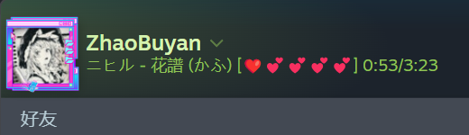
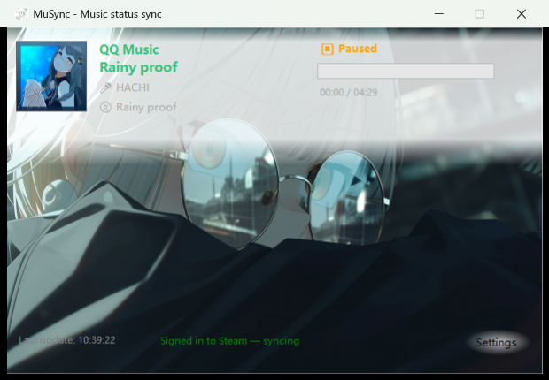

# MuSync

[中文](README_CN.md) ｜ **English**

By [ZhaoBuyan](https://github.com/ZhaoBuyan)

**Sync what you're listening to — and what you're running — to your Steam status, in real time.**

Works with NetEase Cloud Music / QQ Music / LX Music / KuGou Music / TTPlayer — download, sign in, done. Free forever. Runs on 64-bit Windows 10 / 11.





## UI redesign proposals welcome

The interface works, but it is not good looking yet, and its **visual hierarchy** needs the most work. If you have ideas, we would love to hear them. A mockup, a layout suggestion, or a pull request are all welcome.

The direction we want: **use native Windows window chrome and controls**. No hand drawn borders, rounded corners or shadows. Instead, make the information readable through a left navigation pane, grouping, spacing and a clear type scale.

Open an [issue](https://github.com/ZhaoBuyan/MuSync/issues/new) to discuss, or send a PR.

## Quick Start

1. Download **MuSync.exe** (full edition, recommended — a portable single file, just double-click) from [Releases](https://github.com/ZhaoBuyan/MuSync/releases)
2. Sign in to Steam on first launch (mobile authenticator / email code supported). If you hit an "unusual login" warning, follow the in-window instructions: Steam app on your phone → select "Steam Client" → confirm your location
3. Open your music player — that's it, your friends can now see what you're listening to
4. (Optional) Want friends to see which app you're using? Settings → Sync → enable "Sync non-game apps"
5. (Optional) Also sync video from your browser: Settings → Sync → enable
   "Sync media playing in your browser (video / audio)", then move "browser media" to the position
   you want it to take in the priority list below
6. (Optional) Put a heart rate or other data into your status: Settings → Data sources → Add source
   (field reference in [Custom data sources](#custom-data-sources-blocks)), then write `{Name}`
   into a format template in Settings → Display

> **First launch on Windows**: MuSync isn't code-signed yet, so Windows may show a "Windows protected your PC" / unknown-publisher warning. Click **More info** → **Run anyway** — that's the standard prompt for unsigned software, not a sign that anything is wrong.

> **LX Music users**: enable "Open API service" under LX Music → Settings → Open API, and allow LAN access.

> **Co-existing with the Steam client**: signing in to Steam on the same account from both MuSync and the Steam client won't log either out (both are SteamKit sessions). You'll see a device session named MuSync in Steam's account management — that's expected.

## Why MuSync

- The song you're listening to is something only you know — MuSync turns it into a line in your friends list
- No plugins to install, no Steam client to keep running — sign in once and it just syncs
- It syncs app status too (coding in VS Code, playing a non-Steam-launched game) — wording, style and colors are fully yours to define

## Features

### Music sync

- Supports NetEase Cloud Music / QQ Music / LX Music / KuGou Music / TTPlayer (community rebuild)
- **Also syncs media playing in your browser** (Edge / Chrome / Brave / Vivaldi / Opera / Firefox …):
  when you play a video or audio in a browser, its title is synced. This goes through the Windows
  system media controls — no browser memory reads, no injection, no admin rights; the title is
  shown verbatim. **Off by default**, enable it in Settings → Sync
- All six sources share **one priority list** (NetEase / QQ Music / LX / KuGou / TTPlayer / browser media)
  which you can reorder in Settings → Sync with immediate effect
- Multiple players running at once are arbitrated automatically: **whatever is playing wins**;
  when several are playing, your priority order decides
- Music and app sync have independent switches; with "Hide music status when paused" enabled, a paused player never shows up in your friends list

### Custom data sources (blocks)

Plug any HTTP endpoint that returns JSON into the status text as a **template block**.
Heart rate is the typical use case — Settings → Data sources → Add source:

| Field | Example | Meaning |
|---|---|---|
| Name | `Heart` | The block name used in templates, e.g. `{Heart}` |
| URL | `http://127.0.0.1:9000/heartrate` | Any HTTP URL (local services: just use 127.0.0.1) |
| Value | `heart_rate` | Which JSON field to read; nested paths like `a.b.c` work; leave empty for the root value |
| Format | `❤{v}` | `{v}` is replaced by the value; leave empty to show the raw value |
| Every | `1` | How often to poll, in seconds; pushes still follow your sync speed setting |

Then use it in Settings → Display's format template: click the "Blocks" button next to a format box —
**"Data source" is now one of the block types**, and its dropdown lists the sources you configured
```
{song} {Heart}              →  稻香 ❤92
{app} {sep} {song} {Heart}  →  Strinova ‖ 稻香 ❤92
```

- The value may be a **number or text**, so viewer counts, download speed, weather and similar all work
- When the value can't be fetched the block **expands to nothing** and never affects music or app sync;
  unreachable addresses are retried every 5 seconds
- Each row shows its live state (time since last success / current value / failure reason), and the
  "Test as filled" button prints the response and the extracted value so a misconfiguration is obvious

### App sync

- Sync the running state of any app to Steam: games, work software (like VS Code), anything
- A built-in library recognizes 200+ common apps, plus fullscreen detection, to auto-classify them (game / work / media / social — adjustable); the exact count grows with each version and is shown in Settings → Apps and in "Copy diagnostics"
- A newly seen app's name comes from the product name written inside its own executable (e.g. "Plain Craft Launcher" instead of `Plain Craft Launcher 2.exe`); if there is none, the window title is used, and the file name as a last resort. **Fully offline** — only the executable's version resource is read
- The Apps page states where suggestions come from (the local library, offline, reading only process names and window titles) and how large that library is
- New apps land in the list for confirmation; you can also add the current foreground app from Settings
- The main-window panel shows the current state: green = pushed to Steam / yellow = paused (manually or a game was detected) / blue = recognized but **category not confirmed yet** / grey = idle
- Rules can be **exported / imported** (Settings → Apps): export to a JSON file for moving to another machine, backing up, or sharing your tuned category list; import only adds what's missing and never overwrites your local settings, and nothing is written until you confirm
- Two display modes: `When in foreground` (hidden when you switch away) / `Always when running` (shown even while idling)
- System processes and music players are excluded by default; apps categorized as "Ignore" never affect your status

### Display customization

- Block editor: compose the status text from blocks — Song / Artist / Progress bar / App name / Separator / Custom text — reorder freely with a live preview
- Template presets: one click to switch between "Simple / With prefix (Playing·Listening) / Name only"
- Progress bar style: presets plus any characters you like, length 1–50; emoji work out of the box, e.g. `[❤️❤️❤️❤️❤️❤️💕💕💕💕] 1:59/3:32`
- Appearance: title / song colors, font, background color, background image (stretch / fit / tile / center) — all customizable with one-click reset
- Album art: NetEase / QQ Music show the cover provided by the player; **browser media** shows the video's
  artwork (the page poster); the **TTPlayer** community rebuild shows the album art it publishes through the
  system media controls; **KuGou** provides none, so its app icon is used as a placeholder. Whenever no cover
  is available, the app's own icon is used instead — never a blank box
- Crop the background image by dragging a frame after picking it (no frame = use the whole image); the main window scales to the image's aspect ratio, keeping its center and staying on screen
- Combined display and separator are configurable; text over Steam's limit is truncated intelligently at 128 bytes
- Persistent status: when nothing is playing and no app is being synced, show a custom line instead of clearing your status (emoji supported) — toggle it in Settings → Display
- Example output (templates + block editor — fully yours to define):

```
Non-Steam game running
Listening to: Rice Field - Jay Chou [#####-----] 2:30/4:15      ← while listening
Listening to: Rice Field - Jay Chou [❤️❤️❤️❤️❤️❤️💕💕💕💕] 2:30/4:15   ← any progress-bar style / length, paste emoji freely
VS Code ‖ Listening to: Rice Field - Jay Chou                    ← coding while listening (combined template)
Strinova                                                         ← playing a non-Steam-launched game
Rice Field ❤92                                                   ← plus a custom data source (heart rate here)
```

### Steam connection

- Connects directly to the Steam network via SteamKit2; the Steam client doesn't need to be running
- Automatic reconnect with exponential backoff; signs back in with the saved token after recovery
- Falls back to WebSocket (port 443) when TCP fails; the server list is cached locally so it can connect even when official endpoints are unreachable; automatic server switching and retries up to 4 rounds when the server asks you to try another CM
- Auto-pauses while you play a real Steam game, resumes when you exit the game
- The login token is encrypted with Windows DPAPI; network hiccups never wipe your login state
- Sync rate options: Fast 0.25s / Standard 0.5s (recommended) / Data saver 1s

### Desktop & settings

- Two panels on the main window: "Music" (follows the current player) and "App" — with live sync status; double-click the song title to open its page in your browser (NetEase / QQ Music provide such a link; KuGou / TTPlayer do not)
- Lives in the notification area: hover shows the current status, right-click offers "Pause sync" for temporary invisibility, optional start with Windows
- No more high-frequency memory reads while paused: when a player is running but paused, reads drop from every 233 ms to once a second, and playback restarting is noticed within a second (the log records the change as `节拍切换: 暂停档 1s`)
- The Settings dialog is a single window with tabs: General / Sync / Display / Apps / Diagnostics / About
- Update check: on launch, then every 6 hours; new versions surface on the "Settings" button and tray menu; the update dialog can download directly — the full/lite editions use "Exit & open folder" for a manual replace, the installer edition updates with one click ("Update now")
- The Diagnostics tab offers "Copy diagnostics" (one-click copy of the full state) and "Open logs folder"; logs live in `%LocalAppData%\MuSync\logs\` and are cleaned up automatically — only the last 7 days and up to 20 MB are kept

## Editions & Upgrading

> **Which edition?** We recommend **MuSync.exe** (full edition) — a portable single file, just double-click; **MuSync-Setup.exe** (installer edition) suits people who want zero maintenance — new versions auto-update with one click and no manual file replacement; **MuSync-lite.exe** is smaller but requires the [.NET 10 Desktop Runtime](https://dotnet.microsoft.com/download/dotnet/10.0). All three editions are functionally identical and share the same config & login.

Upgrading: the app checks for updates automatically — for the full/lite editions, download then click "Exit & open folder" and drag to replace; for the installer edition, click "Update now" and it's done.

## FAQ

- **Sign-in keeps failing / "Server busy" (TryAnotherCM)**
  This is Steam's risk control reacting to a "new device + network environment change" — it usually clears up within minutes (MuSync automatically switches servers and retries, up to 4 rounds). If it happens often: turn off Steam network tools such as Steam++ (Watt Toolkit) and retry; if you use an accelerator, try to keep the same node.

- **A friend might not see you**
  In rare cases the Steam client's friends list "drops" an individual friend entry, so that person can't see you (your profile still works). This is almost certainly on the Steam client side — right-click refresh or restart the Steam client to recover.

- **LX Music is not detected**
  Please enable "Open API service" under LX Music → Settings → Open API, and allow LAN access.

- **Browser media sync isn't working**
  It's off by default — turn on "Sync media playing in your browser" in Settings → Sync. It relies on the
  browser's system-media-controls support and only appears while media is actually playing (not while paused).
  A browser session can outlive the video; MuSync then treats it as opened/paused. To make video win over music,
  move "browser media" higher in the priority list.

- **A data source (e.g. heart rate) can't be read**
  First open that address in a browser to confirm it really returns JSON, then use "Test as filled" in
  Settings → Data sources: it shows the HTTP status, the raw response, and the value extracted by your
  expression. Usual causes: the service isn't running, the port differs, a wrong value expression
  (it should be a JSON field name such as `heart_rate`; use `data.bpm` for nesting), or a system proxy
  redirecting requests (MuSync bypasses proxies explicitly, but the service itself may have its own rules).

- **Does a data source send my local data anywhere?**
  No. A data source only **fetches** the address you configured; MuSync forwards those values nowhere.
  They're used solely inside your own Steam status text. The feature is off by default.

- **TTPlayer is not detected / which build do I need**
  You need the **community rebuild** ([Sonic853/TTPlayer](https://github.com/Sonic853/TTPlayer)). MuSync reads it through the Windows **System Media Transport Controls (SMTC)**, and the original 2011 TTPlayer 5.7.9 does not implement that interface, so it cannot be read or detected. Detection is based on the app identity (`Sonic853.TTPlayerRebuild`), so changing the build or renaming the executable does not affect it.

- **Will my settings and login survive an upgrade?**
  Yes. Config and login token live in `%LocalAppData%\MuSync\config.json`, separate from the program files, and are picked up automatically after replacing the program (the token is DPAPI-encrypted, so the same PC and user won't need to sign in again).

- **Config or login state looks broken**
  If config parsing fails, the app backs it up automatically (`config.json.bak`) and keeps as much as it can. Logs are in `%LocalAppData%\MuSync\logs` (Settings → Diagnostics → "Open logs folder").

- **Found a problem or have a suggestion?**
  Please open a [GitHub Issue](https://github.com/ZhaoBuyan/MuSync/issues) — attaching the output of Settings → Diagnostics → "Copy diagnostics" helps a lot.

- **How do I uninstall MuSync?**
  Installer edition: uninstall from Windows "Settings → Apps", or via the Start Menu shortcut. The uninstaller removes the program files only — your config and logs in `%LocalAppData%\MuSync` are kept; delete that folder for a complete cleanup. Full and lite editions: just delete the program file.

## Security & privacy

Before you hand your Steam account to MuSync, please read [SECURITY.md](SECURITY.md): the sign-in flow, what it reads, network traffic, the risks, and how to revoke access — all explained honestly.

## Relationship to upstream

MuSync's player memory-reading implementation descends from an open-source lineage (all MIT licensed):

```
MuSync (this project)
 └─ wuyan1337/yySync ............... direct base (the Steam-sync edition)
     └─ kriYamiHikari/Music-DiscordRPC
         └─ Kxnrl/NetEase-Cloud-Music-DiscordRPC
             └─ Copyright (c) 2018 Kyle's original project
```

Only the player readers that use memory reverse-engineering (NetEase pattern scan / QQ Music offsets / the LX interface) come from that lineage; everything else — including the KuGou reader, the TTPlayer reader (which uses the Windows System Media Transport Controls, not memory), the connection layer, state arbitration, display engine, app sync, config and security systems — is implemented independently by this project. As a note: the Chinese description 「半新写」 literally means "only half rewritten" — it refers to this lineage, not to a project name. For the full list of changes relative to yySync, see [CHANGELOG.md](CHANGELOG.md).

## Build & test

```powershell
dotnet build MuSync.sln -c Release     # build
dotnet test  MuSync.sln                # unit tests

# Portable single-file publish (bundled .NET runtime)
dotnet publish MuSync.csproj -c Release -r win-x64 --self-contained true -p:PublishSingleFile=true -p:EnableCompressionInSingleFile=true -o publish

# Installer (requires Inno Setup 6.5+)
powershell -ExecutionPolicy Bypass -File installer\build.ps1
```

CI (on `main` push / `v*` tag) builds three artifacts: `MuSync.exe` (portable, full edition), `MuSync-lite.exe` (lightweight, requires .NET 10 runtime), and `MuSync-Setup.exe` (installer edition).

Before changing code, read [docs/STANDARDS.md](docs/STANDARDS.md) (comment conventions, testing requirements, where docs live, release flow).

## Project layout

```
MuSync.csproj                  # main app (WinForms)
Program.cs                     # entry point / tray / update checks
MainForm.cs                    # main window
SettingsForm.cs                # settings dialog (single window, tabs)
FormatBlockEditorForm.cs       # block editor
BackgroundCropForm.cs          # background image crop window
UpdateForm.cs                  # update dialog (download / open release page)
SteamLoginForm.cs              # Steam sign-in window
LicenseForm.cs                 # open-source licence viewer
RpcManager.cs                  # state arbitration and push (sync loop)
SteamSessionManager.cs         # Steam connection and sign-in
SteamStatusManager.cs          # Steam status text push
Configurations.cs              # config load/save and encryption
Players/                       # player readers (NetEase / QQ / LX Music / KuGou / TTPlayer)
Utils/                         # foreground watcher / classifier / template codec / updates / logging / DPAPI etc.
Models/                        # data models
Win32Api/                      # Win32 / process memory access
installer/                     # Inno Setup installer script and local build
tools/                         # icon generator script (make-icon.ps1)
tests/MuSync.Tests/            # xUnit unit tests
reference-yySync/              # upstream reference source (MIT; not compiled, for comparison only)
```

## License & credits

MuSync is built on an open-source lineage (see "Relationship to upstream" above), with thanks to everyone who paved the way:

- [wuyan1337/yySync](https://github.com/wuyan1337/yySync) — the direct base
- [kriYamiHikari/Music-DiscordRPC](https://github.com/kriYamiHikari/Music-DiscordRPC)
- [Kxnrl/NetEase-Cloud-Music-DiscordRPC](https://github.com/Kxnrl/NetEase-Cloud-Music-DiscordRPC)
- [SteamRE/SteamKit](https://github.com/SteamRE/SteamKit) — Steam network protocol support

Released under the MIT license, see [LICENSE](LICENSE). Full third-party license texts are in [THIRD-PARTY-NOTICES.md](THIRD-PARTY-NOTICES.md).
